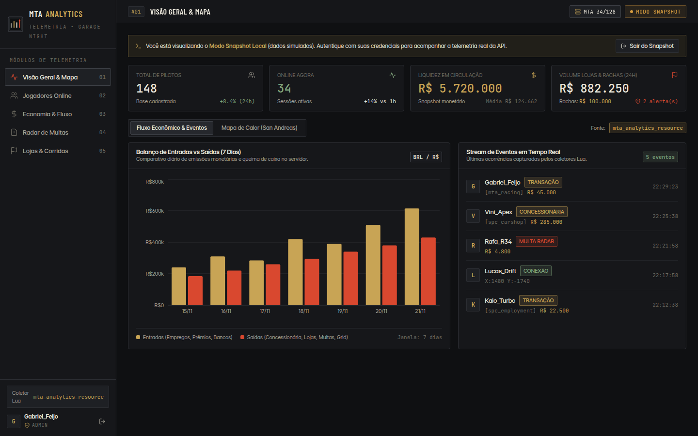
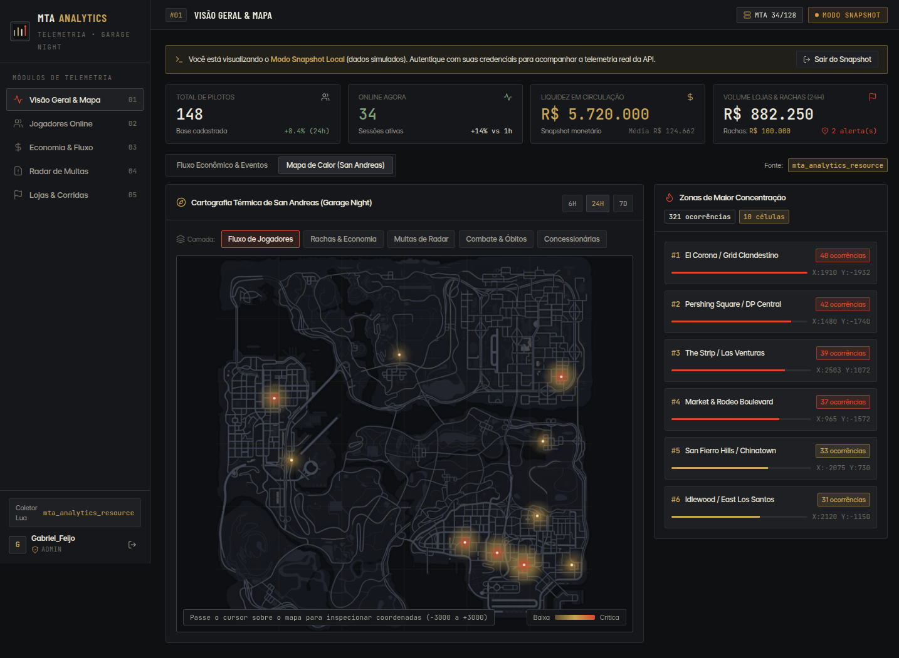
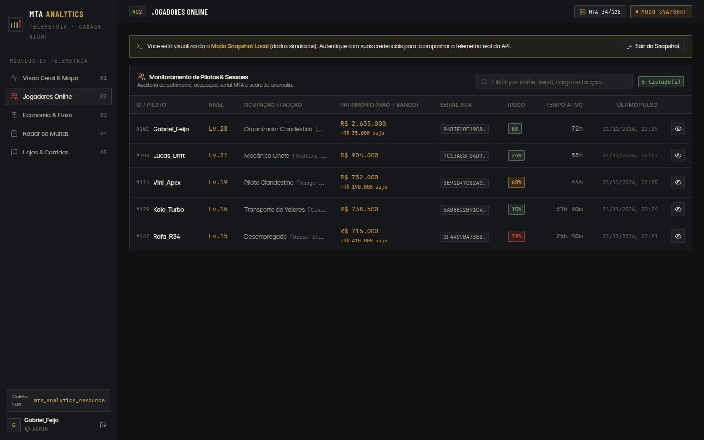
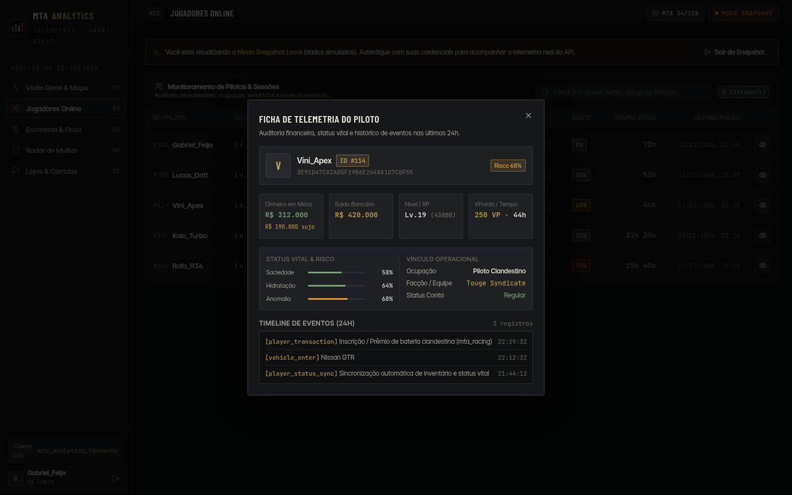
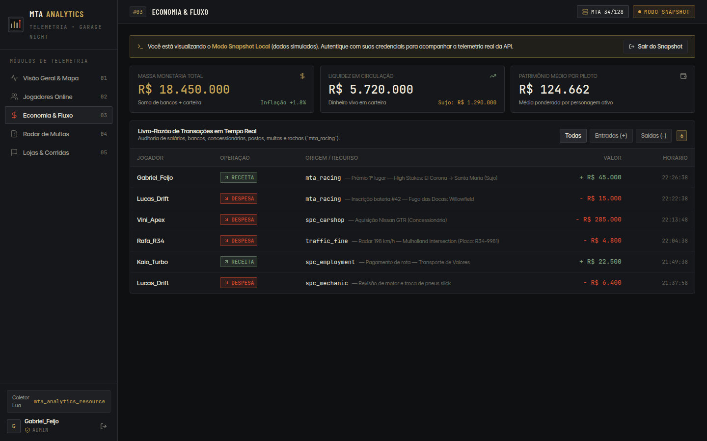
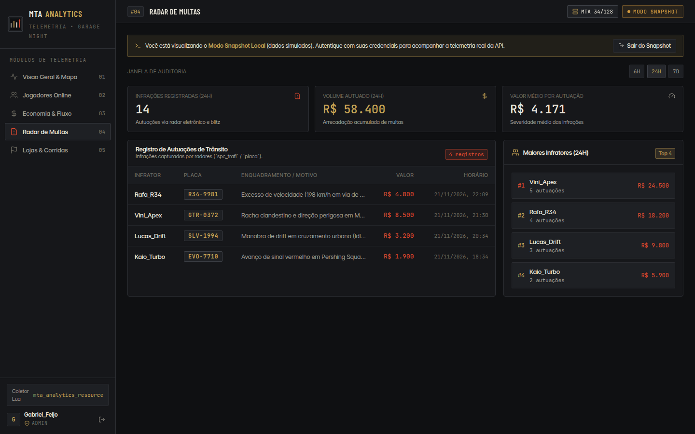
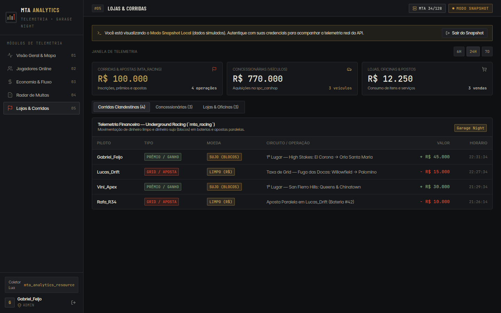

# 📊 MTA Garage Night Analytics (`mta_analytics`)

> Plataforma full-stack de telemetria, auditoria econômica, cartografia térmica e detecção de anomalias em tempo real para **MTA:SA Roleplay**, composta por coletor Lua 100% server-side com assinatura HMAC-SHA256, API NestJS + Prisma + Bull/Redis, WebSocket autenticado e dashboard SPA projetado no design system **"Garage Night"** em conjunto com o `mta_radar`, o `mta_racing` e o `mta_speedometer`.

[](https://multitheftauto.com/)
[](https://www.lua.org/)
[](https://nestjs.com/)
[](https://react.dev/)
[](https://www.typescriptlang.org/)
[](https://vitejs.dev/)
[](https://tailwindcss.com/)
[](https://www.postgresql.org/)
[](https://redis.io/)
[](frontend/src/styles/tokens.css)

---

## 📸 Preview do Painel

### Visão geral e telemetria ao vivo


### Cartografia térmica de San Andreas (Heatmap)


### Auditoria de pilotos e ficha de telemetria
| Monitoramento de pilotos online e risco | Ficha completa de telemetria do piloto |
| :---: | :---: |
|  |  |

### Economia e radar de multas
| Massa monetária e livro-razão em tempo real | Autuações de trânsito e maiores infratores |
| :---: | :---: |
|  |  |

### Lojas, concessionárias e corridas clandestinas (`mta_racing`)


---

## 🎯 Destaques

- **Coletor Lua 100% Server-Side & Blindado (`mta_analytics_resource`)**: credenciais (`API.key` e `API.secret`) isoladas exclusivamente em [`server/config.lua`](mta_analytics_resource/server/config.lua) sem exposição ao client, assinatura **HMAC-SHA256 RFC 2104** real sobre `timestamp .. "." .. body` ([`crypto.lua`](mta_analytics_resource/server/core/crypto.lua)), sanitização contra tabelas vazias no `toJSON` ([`utils.lua`](mta_analytics_resource/server/core/utils.lua)), agregação de rajadas de dano (`onPlayerDamage`) em janela de `1500ms` ([`combat-events.lua`](mta_analytics_resource/server/collectors/combat-events.lua)) e **Circuit Breaker FSM** (`CLOSED` / `OPEN` / `HALF_OPEN`) com backoff exponencial até `300s` e descarte de erros `4xx` sem travar a fila ([`request.lua`](mta_analytics_resource/server/core/request.lua)).
- **Backend NestJS Seguro & Endurecido**: [`ApiKeyGuard`](backend/src/common/guards/api-key.guard.ts) com `crypto.timingSafeEqual` e janela anti-replay de `±5 min`, middlewares `helmet` e `compression`, CORS restrito por `CORS_ORIGIN`, validação fail-fast de variáveis de ambiente ([`env.validation.ts`](backend/src/common/config/env.validation.ts)), rate limiting em Redis para `/auth/login` e `/auth/register` ([`rate-limit.guard.ts`](backend/src/common/guards/rate-limit.guard.ts)), RBAC por `Role`, revogação real de sessão via `POST /api/auth/logout` + denylist no Redis e WebSocket `/analytics` com verificação JWT real ([`analytics.gateway.ts`](backend/src/analytics/analytics.gateway.ts)).
- **Processamento Assíncrono, SQL Nativo & Motor de Risco (`0.0–1.0`)**: ingestão em lote com retries exponenciais na Bull Queue + pipeline Redis ([`mta.service.ts`](backend/src/mta/mta.service.ts)), serviços SRP em `backend/src/analytics/services/`, agregações SQL diretas no PostgreSQL para mapa de calor (`FLOOR("positionX" / gridSize)`), massa monetária (`SUM(money + bank)` + `dirtyMoney`) e fluxo de 7 dias (`DATE_TRUNC('day', timestamp)`), cálculo automático de `riskScore` ([`risk-scoring.service.ts`](backend/src/analytics/services/risk-scoring.service.ts)) e job diário de retenção de posições/sessões (`EVENT_RETENTION_DAYS=14`).
- **Design System "Garage Night" Compartilhado**: paleta noturna de alta legibilidade definida em [`tokens.css`](frontend/src/styles/tokens.css) (`#0F1012` / `#16171A` / `#1E2024`, **Sinal `#D9482F`**, **Latão `#C8A455`**, **Sálvia `#7FA37A`**, **Âmbar `#D49B3F`**), fontes locais embarcadas (`Barlow Condensed`, `Inter Tight`, `JetBrains Mono`) com números tabulares (`tabular-nums`) e cartografia noturna de San Andreas (`map-garage-night.png`).
- **Frontend SPA Modular (`kebab-case`) & WebSocket Único**: conexão Socket.IO única compartilhada por [`AnalyticsSocketProvider`](frontend/src/contexts/analytics-socket-context.tsx), [`useAuthStore`](frontend/src/stores/auth-store.ts) como fonte única de sessão, busca de pilotos com debounce (`300ms`), janelas dinâmicas (`6H | 24H | 7D`), drawer responsivo para mobile ([`app-layout.tsx`](frontend/src/components/layout/app-layout.tsx)) e **Modo Snapshot Local** isolado em [`telemetry-snapshot.ts`](frontend/src/mocks/telemetry-snapshot.ts) com banner explícito.
- **Integração Direta com o Ecossistema RP**: auditoria unificada de corridas clandestinas (`mta_racing` em dinheiro limpo e blocos sujos), concessionárias (`spc_carshop`), lojas, oficinas, postos e radares de trânsito (`fine_issued` com placa e autuação).

---

## 🔌 API, WebSocket e Exports

### Endpoints REST (`/api`)

| Grupo | Endpoint | Autenticação | Finalidade |
| :--- | :--- | :--- | :--- |
| **Ingestão MTA** | `POST /api/mta/event` · `POST /api/mta/events/batch` · `POST /api/mta/heartbeat` | HMAC-SHA256 + `x-api-key` | Recebe evento unitário, lote (`1..200`) e pulso de saúde do servidor |
| **Autenticação** | `POST /api/auth/login` · `POST /api/auth/register` | Público (Rate-Limit Redis) | Autentica operador ou registra (1º admin livre; demais restritos) |
| **Sessão** | `GET /api/auth/me` · `POST /api/auth/logout` | JWT Bearer | Perfil do operador autenticado e revogação de token/sessão |
| **Analytics** | `GET /api/analytics/dashboard` · `server-status` · `overview` · `heatmap` · `events/recent` · `players/:id/activity` · `resources` · `fines` | JWT Bearer | KPIs do painel, status do servidor, fluxo 7d, heatmap SQL, recursos e multas |
| **Jogadores** | `GET /api/players/online` · `search?q=` · `:id` · `:id/stats` | JWT Bearer | Jogadores ativos (últimos 5 min), busca global e ficha completa |
| **Economia** | `GET /api/economy/snapshot` · `timeseries` · `transactions/recent` · `transactions/player/:id` | JWT Bearer | Snapshot monetário, séries (`24h`/`7d`/`30d`) e livro-razão |

### WebSocket em Tempo Real (`ws://.../analytics`)

| Direção | Evento | Payload / Comportamento |
| :--- | :--- | :--- |
| **Conexão** | `connect` (`auth: { token }`) | Valida JWT + checagem de revogação e emite `initial-data` |
| **Cliente → Servidor** | `subscribe:heatmap` · `subscribe:players` | Entra na sala e recebe `heatmap:data` ou `players:list` |
| **Servidor → Cliente** | `event:new` · `player:online` · `player:offline` · `economy:update` | Atualiza feed, contagem online e snapshot econômico em tempo real |

### Exports do Resource Lua ([`meta.xml`](mta_analytics_resource/meta.xml))

- `logTransaction(player, transType, amount, description)` (`server`) → registra movimentação financeira tipada (`job_payout`, `shop_purchase`, `race_dirty_earn`, `deposit`, etc.)
- `logMoneyChange(player, amount, newBalance, changeSource)` (`server`) → registra variação direta de saldo (`player_money_change`)
- `logVehiclePurchase(player, model, price, paymentMethod)` (`server`) → registra aquisição em concessionária (`vehicle_purchase`)
- `logFine(player, amount, reason, plate)` (`server`) → registra autuação de radar/trânsito (`fine_issued`)
- `logEvent(player, eventType, data)` (`server`) → registra evento customizado de qualquer resource externo
- `getQueueStatus()` (`server`) → retorna `{ pending, totalQueued, totalDropped, circuitOpen, circuitState, inFlight }`

```lua
-- Exemplo em outro resource server-side (ex.: mta_racing ou spc_carshop)
exports["mta_analytics_resource"]:logTransaction(player, "race_dirty_earn", 45000, "1º Lugar — High Stakes: El Corona")
exports["mta_analytics_resource"]:logFine(player, 4800, "Radar 198 km/h — Mulholland", "R34-9981")
```

---

## 📦 Estrutura do Projeto

```text
[MTA-ANALYTICS]/
├── backend/                                        # API NestJS + Bull Queue + Prisma ORM
│   ├── prisma/
│   │   ├── migrations/                             # Histórico versionado de migrations SQL
│   │   └── schema.prisma                           # Modelos Admin, Session, Player, Event, Transaction, Metrics
│   ├── src/
│   │   ├── analytics/
│   │   │   ├── dto/analytics-query.dto.ts          # Validação de queries (heatmap, hours, limit)
│   │   │   ├── processors/
│   │   │   │   ├── event-mapper.ts                 # Mapeamento puro de métricas e transações (+ .spec.ts)
│   │   │   │   ├── event.processor.ts              # Consumer Bull de eventos, sessões e risco
│   │   │   │   └── metric.processor.ts             # Cron horário (economia/online) e retenção diária
│   │   │   ├── services/
│   │   │   │   ├── dashboard-analytics.service.ts  # KPIs, tendências, heartbeat e timeline do piloto
│   │   │   │   ├── economy-metrics.service.ts      # Snapshot e overview 7d via SQL agregado
│   │   │   │   ├── heatmap-analytics.service.ts    # Grid espacial SQL (FLOOR / LIMIT 2000)
│   │   │   │   ├── resource-fines-analytics.service.ts # Agregação de lojas, corridas e multas
│   │   │   │   └── risk-scoring.service.ts         # Motor de score de anomalia 0.0–1.0 (+ .spec.ts)
│   │   │   ├── analytics.controller.ts             # Endpoints REST /api/analytics/*
│   │   │   ├── analytics.gateway.ts                # Gateway Socket.IO /analytics autenticado via JWT
│   │   │   ├── analytics.module.ts                 # Registro de filas Bull e serviços SRP
│   │   │   └── analytics.service.ts                # Fachada e agendamento de jobs recorrentes
│   │   ├── auth/
│   │   │   ├── dto/auth.dto.ts                     # DTOs LoginDto e RegisterDto
│   │   │   ├── strategies/jwt.strategy.ts          # Estratégia Passport JWT com checagem de revogação
│   │   │   ├── auth.controller.ts                  # Login, registro, perfil e logout com rate limit
│   │   │   ├── auth.module.ts                      # Configuração JWT e Passport
│   │   │   └── auth.service.ts                     # Autenticação, bootstrap de 1º admin e denylist Redis
│   │   ├── common/
│   │   │   ├── config/env.validation.ts            # Validação fail-fast de variáveis de ambiente
│   │   │   ├── decorators/                         # Decorators @RateLimit e @Roles
│   │   │   └── guards/                             # ApiKeyGuard (+ .spec.ts), JwtAuthGuard, RateLimitGuard, RolesGuard
│   │   ├── database/                               # PrismaService e RedisService (ioredis + pipeline)
│   │   ├── economy/                                # Endpoints e validações de economia e transações (+ .spec.ts)
│   │   ├── mta/                                    # DTOs e ingestão autenticada do resource Lua
│   │   ├── players/                                # Consulta de jogadores online, busca e estatísticas
│   │   ├── app.module.ts                           # Módulo raiz (Config, Bull, módulos de domínio)
│   │   └── main.ts                                 # Bootstrap HTTP (helmet, compression, rawBody, CORS, pipes)
│   ├── .env.example                                # Template de configuração do backend
│   ├── docker-compose.yml                          # PostgreSQL 16 + Redis 7 com healthchecks
│   ├── package.json                                # Dependências enxutas e scripts (type-check, build, test)
│   └── README.md                                   # Documentação específica do backend
├── frontend/                                       # Painel SPA React + Vite + Tailwind CSS (Garage Night)
│   ├── public/
│   │   ├── assets/map-garage-night.png             # Cartografia noturna de San Andreas para o heatmap
│   │   └── fonts/                                  # Barlow Condensed, Inter Tight e JetBrains Mono
│   ├── src/
│   │   ├── components/
│   │   │   ├── common/                             # DemoModeBanner, QueryErrorState e TimeWindowSelector
│   │   │   ├── dashboard/                          # EconomyOverviewChart, HeatmapView, MetricCard, RecentActivity
│   │   │   ├── economy/transaction-table.tsx       # Livro-razão de transações com leitura de metadata
│   │   │   ├── layout/                             # AppLayout responsivo (drawer mobile) e BrandLogo
│   │   │   ├── players/                            # PlayerTable, PlayerDetailsDialog e TelemetryMeter
│   │   │   └── ui/                                 # Primitivos React puros estilizados no Garage Night
│   │   ├── contexts/analytics-socket-context.tsx   # Conexão Socket.IO única com multiplexação de listeners
│   │   ├── hooks/                                  # useAnalyticsSocket e useDebouncedValue
│   │   ├── lib/                                    # cn, formatters e matemática espacial (san-andreas-map.ts)
│   │   ├── mocks/telemetry-snapshot.ts             # Dataset isolado para o Modo Snapshot Local
│   │   ├── pages/                                  # dashboard, players, economy, fines, resources, login, register
│   │   ├── services/                               # http-client Axios e módulos auth/analytics/players/economy
│   │   ├── stores/                                 # Stores Zustand (auth-store e dashboard-store)
│   │   ├── styles/                                 # Tokens CSS Garage Night e estilos globais
│   │   ├── types/telemetry.ts                      # Contratos TypeScript estritos (zero any)
│   │   ├── app.tsx                                 # Roteamento autenticado e público
│   │   └── main.tsx                                # Entry point React + React Query
│   ├── .env.example                                # URLs VITE_API_URL e VITE_WS_URL
│   ├── package.json                                # Dependências enxutas e scripts (dev, type-check, build)
│   └── README.md                                   # Documentação específica do frontend
├── mta_analytics_resource/                         # Resource Lua 100% server-side para MTA:SA
│   ├── server/
│   │   ├── collectors/                             # combat-events.lua, player-details.lua, player-events.lua
│   │   ├── core/                                   # crypto.lua, exports.lua, queue.lua, request.lua, utils.lua
│   │   ├── config.lua                              # Credenciais HTTP, intervalos, chaves elementData e debug
│   │   └── main.lua                                # Timers de heartbeat, posição, status sync e shutdown flush
│   ├── meta.xml                                    # Manifesto, ordem de scripts server-side, exports e ACL
│   └── README.md                                   # Documentação específica do resource Lua
├── docs/images/                                    # Capturas reais do painel usadas neste README
└── README.md                                       # Visão geral completa do projeto
```

---

## 🚀 Instalação, Ativação e Verificação

### 1. Subir PostgreSQL e Redis (Docker)

```bash
cd backend
docker-compose up -d
```

### 2. Configurar e iniciar o Backend

```bash
cd backend
npm install
cp .env.example .env
npx prisma generate
npx prisma migrate deploy
npm run start:dev
```

### 3. Configurar e iniciar o Frontend

```bash
cd frontend
npm install
cp .env.example .env
npm run dev
```

- **Painel Web**: `http://localhost:5173` (sem backend ativo, use **Inspecionar Telemetria (Snapshot Local)** na tela de login)
- **API REST**: `http://localhost:3000/api`
- **WebSocket**: `ws://localhost:3000/analytics`

### 4. Ativação do Resource no Servidor MTA:SA

1. Ajuste `Config.API.url`, `Config.API.key` e `Config.API.secret` em [`mta_analytics_resource/server/config.lua`](mta_analytics_resource/server/config.lua) alinhando com `MTA_API_KEYS` e `MTA_SECRET` do backend.
2. Garanta permissão ACL para `function.fetchRemote` declarada em [`meta.xml`](mta_analytics_resource/meta.xml) (`aclrequest allow mta_analytics_resource all`).
3. No console do servidor MTA:

```text
refresh
start mta_analytics_resource
```

### 5. Verificação Automatizada

```bash
# Backend: Prisma Client, tipagem estrita, build e testes unitários
cd backend && npx prisma generate && npm run type-check && npm run build && npm test

# Frontend: tipagem estrita e bundle de produção
cd frontend && npm run type-check && npm run build
```

---

Desenvolvido por **Gabriel Feijó**.
