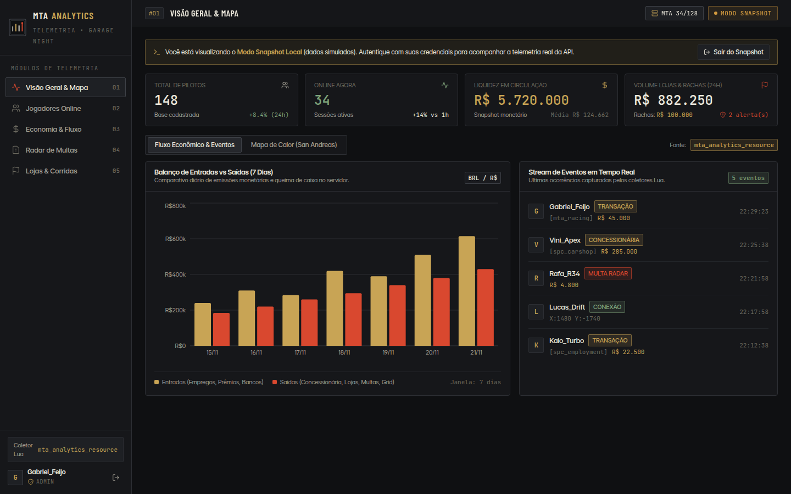

# 🖥️ MTA Analytics Dashboard (`frontend`)

> Painel SPA em **React + TypeScript + Vite + Tailwind CSS** projetado no design system **"Garage Night"**, com conexão WebSocket única, cartografia térmica 2D em Canvas de San Andreas, auditoria financeira em tempo real e Modo Snapshot Local isolado.

[](https://react.dev/)
[](https://www.typescriptlang.org/)
[](https://vitejs.dev/)
[](https://tailwindcss.com/)
[](src/styles/tokens.css)

---

## 📸 Preview da Interface



---

## 🎯 Destaques

- **Design System "Garage Night"**: tokens em [`src/styles/tokens.css`](src/styles/tokens.css) (`bg0` `#0F1012`, `bg1` `#16171A`, `bg2` `#1E2024`, **Sinal `#D9482F`**, **Latão `#C8A455`**, **Sálvia `#7FA37A`**, **Âmbar `#D49B3F`**), fontes locais embarcadas em `public/fonts/` (`Barlow Condensed`, `Inter Tight`, `JetBrains Mono`) e números tabulares (`tabular-nums`).
- **Conexão WebSocket Única**: [`AnalyticsSocketProvider`](src/contexts/analytics-socket-context.tsx) gerencia uma única instância Socket.IO (`/analytics`) por aba autenticada com multiplexação de assinantes (`subscribe`/`unsubscribe`) e desativação automática no Modo Snapshot.
- **Cartografia Térmica 2D (`-3000` a `+3000`)**: [`heatmap-view.tsx`](src/components/dashboard/heatmap-view.tsx) + [`san-andreas-map.ts`](src/lib/san-andreas-map.ts) renderizam camadas por tipo de evento sobre `map-garage-night.png` com inspeção interativa de zonas e janelas `6H | 24H | 7D`.
- **Arquitetura Modular `kebab-case` & Zero `any`**: tipos completos em [`src/types/telemetry.ts`](src/types/telemetry.ts), serviços HTTP separados por domínio em `src/services/`, estado de sessão unificado em [`auth-store.ts`](src/stores/auth-store.ts), busca com debounce (`300ms`), menu mobile em drawer e dataset demo isolado em [`telemetry-snapshot.ts`](src/mocks/telemetry-snapshot.ts).

---

## 🧭 Páginas e Módulos

| Rota | Página | Funcionalidades |
| :--- | :--- | :--- |
| `/` | [`dashboard.tsx`](src/pages/dashboard.tsx) | 4 KPIs ao vivo, gráfico Recharts de 7 dias, stream de eventos e aba de Heatmap |
| `/players` | [`players.tsx`](src/pages/players.tsx) | Tabela de pilotos online, busca global com debounce (`300ms`) e modal de ficha |
| `/economy` | [`economy.tsx`](src/pages/economy.tsx) | Massa monetária, liquidez + dinheiro sujo, inflação e livro-razão filtrável |
| `/fines` | [`fines.tsx`](src/pages/fines.tsx) | Seletor `6H / 24H / 7D`, registro de autuações com placa e ranking de infratores |
| `/resources` | [`resources.tsx`](src/pages/resources.tsx) | Seletor `6H / 24H / 7D`, corridas clandestinas (`mta_racing`), veículos e lojas |
| `/login` · `/register` | [`login.tsx`](src/pages/login.tsx) · [`register.tsx`](src/pages/register.tsx) | Autenticação JWT, entrada no Modo Snapshot Local e cadastro de operador |

---

## 📦 Estrutura do Projeto

```text
frontend/
├── public/
│   ├── assets/map-garage-night.png            # Textura cartográfica de San Andreas
│   └── fonts/                                 # Barlow Condensed, Inter Tight e JetBrains Mono
├── src/
│   ├── components/
│   │   ├── common/
│   │   │   ├── demo-mode-banner.tsx           # Banner de aviso e saída do Modo Snapshot
│   │   │   ├── query-error-state.tsx          # Estado de erro com ação de retry
│   │   │   └── time-window-selector.tsx       # Seletor reutilizável 6H | 24H | 7D
│   │   ├── dashboard/
│   │   │   ├── economy-overview-chart.tsx     # Gráfico Recharts (Entradas vs Saídas 7d)
│   │   │   ├── heatmap-view.tsx               # Mapa de calor Canvas e zonas de concentração
│   │   │   ├── metric-card.tsx                # Card KPI reutilizável Garage Night
│   │   │   └── recent-activity.tsx            # Feed de eventos recentes
│   │   ├── economy/
│   │   │   └── transaction-table.tsx          # Tabela de livro-razão com metadata
│   │   ├── layout/
│   │   │   ├── app-layout.tsx                 # Shell principal, drawer mobile e status MTA/WS
│   │   │   └── brand-logo.tsx                 # Emblema vetorial Garage Night
│   │   ├── players/
│   │   │   ├── player-details-dialog.tsx      # Modal de auditoria vital, financeira e timeline
│   │   │   ├── player-table.tsx               # Tabela de pilotos com patrimônio e risco
│   │   │   └── telemetry-meter.tsx            # Medidor linear de saciedade/hidratação/risco
│   │   └── ui/                                # Badge, Button, Card, Dialog, Input, Table, Tabs
│   ├── contexts/
│   │   └── analytics-socket-context.tsx       # Provider global de Socket.IO único
│   ├── hooks/
│   │   ├── use-analytics-socket.ts            # Hook de assinatura de eventos WS
│   │   └── use-debounced-value.ts             # Debounce genérico (300ms)
│   ├── lib/
│   │   ├── cn.ts                              # Utilitário clsx + tailwind-merge
│   │   ├── formatters.ts                      # Formatadores pt-BR de moeda, data, hora e playtime
│   │   └── san-andreas-map.ts                 # Projeção de coordenadas, regiões e renderização 2D
│   ├── mocks/
│   │   └── telemetry-snapshot.ts              # Dados simulados para o Modo Snapshot Local
│   ├── pages/                                 # dashboard, economy, fines, login, players, register, resources
│   ├── services/
│   │   ├── analytics-api.ts                   # Chamadas de dashboard, heatmap, recursos e multas
│   │   ├── auth-api.ts                        # Login, registro, perfil e logout com revogação
│   │   ├── economy-api.ts                     # Snapshot, séries temporais e transações
│   │   ├── http-client.ts                     # Instância Axios com bearer token e interceptor 401
│   │   └── players-api.ts                     # Online, busca e detalhes do jogador
│   ├── stores/
│   │   ├── auth-store.ts                      # Sessão JWT e flag isDemoMode persistidas (Zustand)
│   │   └── dashboard-store.ts                 # Estado reativo de KPIs e feed WebSocket
│   ├── styles/
│   │   ├── globals.css                        # Font-faces e estilos base Tailwind
│   │   └── tokens.css                         # Variáveis de cor, raio e tipografia Garage Night
│   ├── types/
│   │   └── telemetry.ts                       # Contratos TypeScript de toda a aplicação
│   ├── app.tsx                                # Roteador principal
│   ├── main.tsx                               # Entry point React + QueryClientProvider
│   └── vite-env.d.ts                          # Tipagens de ambiente Vite
├── .env.example                               # VITE_API_URL e VITE_WS_URL
├── index.html                                 # Documento HTML base (class="dark")
├── package.json                               # Dependências enxutas e scripts
├── tailwind.config.js                         # Extensão de tema com os tokens Garage Night
└── README.md                                  # Documentação do frontend
```

---

## 🚀 Instalação e Scripts

```bash
cd frontend
npm install
cp .env.example .env
npm run dev
```

### Scripts disponíveis ([`package.json`](package.json))

```bash
npm run dev         # Dev server local (http://localhost:5173)
npm run type-check  # Verificação estrita de tipos (tsc --noEmit)
npm run build       # Type-check + build otimizado para produção em dist/
npm run preview     # Preview local do bundle gerado em dist/
```

---

Desenvolvido por **Gabriel Feijó**.
